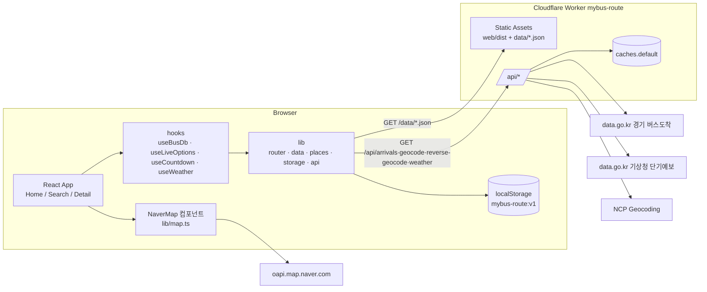

# 01. 아키텍처 설계 — 미니멀 화이트 리디자인 + 날씨 (2026-11-19)

## 프로젝트 개요
- **프로젝트명**: mybus-route
- **설명**: 성남시 정류장 기준으로 "지금 출발하면 가장 빨리 도착하는" 버스 경로(직행·1회 환승)를 실시간으로 추천하는 모바일 우선 웹앱.
- **타깃 사용자**: 같은 경로로 출퇴근하는 개인(본인). 휴대폰 세로 화면.
- **규모**: 소규모. 서버 1개(Cloudflare Worker), DB·인증 없음.
- **이번 작업**: `main.ts`/`style.css`/`index.html`을 React 화면(홈·검색·상세)으로 다시 만들고, `/api/weather`를 마무리한다. 경로 로직은 그대로 재사용한다.

## 기능 요구사항 (doc/requirements.md 기준)
| # | 기능 | 이번 작업에서의 설명 | 우선순위 |
|---|---|---|---|
| FR-1.1/1.7 | 지도 선택 | 검색 화면 지도에서 정류장·임의 위치를 눌러 출발/도착 지정 | P0 |
| FR-1.2~1.4 | 자동완성 | 이름·번호·초성, 주소(Geocoding), "○○ 방면" 힌트 | P0 |
| FR-1.5 | 출발·도착 바꾸기 | 검색 화면 ⇅ 버튼 | P0 |
| FR-1.6 | 주소 출발지 | 500m 근처 정류장 + 도보 시간 (router.ts 그대로) | P0 |
| FR-3 | 최근 검색 | 홈 하단 칩, 누르면 검색 화면에서 즉시 검색, × 삭제 | P0 |
| FR-4.1~4.4 | 실시간 경로 | 검색 결과 카드(시간 막대), 상세 화면(구간별) | P0 |
| FR-4.5 | 출발 정류장 도착판 | 검색 화면 결과 아래 "○○ 정류장 실시간" | P1 |
| FR-4.6 | 추정 표시 | 시간 막대 빗금 + "추정" 배지 | P0 |
| FR-4.7 | 자동·수동 갱신 | 30초 자동(보일 때만), ↻ 버튼, 1초 카운트다운 | P0 |
| FR-5 | 즐겨찾기 | 상세에서 ☆ 저장, 홈 카드 실시간, 편집 모드에서 이름 변경·삭제 | P0 |
| FR-6.1 | 날씨 한 줄 | 홈 최상단 (ADR-024) | P1 |
| FR-6.2 | 날씨 실패 격리 | 실패·로딩 중에는 줄 자체를 숨김 | P0 |

## 비기능 요구사항
| # | 항목 | 요구사항 |
|---|---|---|
| NFR-1 | 스택 | TS + Vite + React (ADR-001, ADR-025) |
| NFR-2 | 지도 | 네이버 지도 JS API, 검색·상세 화면에서만 로드 (ADR-002, ADR-022) |
| NFR-3/5 | 배포·비용 | Worker 하나, 무료 플랜 (ADR-020). 이번엔 배포 안 함 |
| NFR-4 | 보안 | 키는 Worker Secret 에만. 브라우저 번들에는 `VITE_NAVER_MAP_CLIENT_ID`(도메인 제한)만 |
| NFR-6 | 호출 수 | 도착정보 20초·날씨 10분 Worker 캐시, 클라이언트 15초 메모(api.ts), 숨김 탭에서 갱신 중지 |
| NFR-7 (신규) | 화면 | 375px 폭에서 가로 스크롤 없음, 터치 영역 ≥44px, 다크 모드 (ADR-014, ADR-021) |
| NFR-8 (신규) | 성능 | 1초 틱에서 경로 재계산 금지(표시만 갱신). 즐겨찾기 N개 = evaluate 1회 |

## 기술 스택
| 구분 | 기술 | 근거 |
|---|---|---|
| UI | React 19 + react-dom, Vite, TypeScript | ADR-025. Next.js 불필요(정적 배포) |
| 스타일 | 일반 CSS + CSS 변수 토큰 (`tokens.css`), 컴포넌트별 CSS 파일 | ADR-021/025, Tailwind 금지 |
| 상태 | React state + Context 2개(DbContext, StoreContext) + 커스텀 훅 | 화면 3개, 전역 상태 적음 → Zustand/React Query 불필요 |
| 라우팅 | 라이브러리 없음. `view` 상태 + `history.pushState` | 아래 "내비게이션" |
| 테스트 | Vitest (신규 devDependency) | 시간 막대 계산·포맷 함수 단위 테스트 |
| API | Cloudflare Worker (`worker/src`) | ADR-020 |

## 시스템 아키텍처


## 디렉토리 구조 (web/src 목표)
```
web/
  index.html              # <div id="root"> 만. theme-color 를 토큰 값으로
  src/
    main.tsx              # createRoot, Provider 감싸기
    App.tsx               # view 상태 + history 연동, 화면 전환
    styles/  tokens.css  base.css  map.css(기존 .stop-dot/.picker/.pin 이전)
    lib/                  # React 무관 모듈 — 내용 수정 최소화, 경로만 이동
      api.ts config.ts data.ts places.ts router.ts storage.ts util.ts   # web/src/*.ts 에서 그대로 이동
      map.ts              # 이동 + MapView 에 destroy() 추가 (map.destroy())
      timebar.ts          # 신규: OptionResult → 세그먼트 (순수 함수, 테스트 대상)
      routeType.ts        # 신규: 노선 종류 문자열 → 토큰 키
      weather.ts          # 신규: fetchWeather() + 문장 만들기 formatWeather()
    hooks/  useBusDb.ts useSaved.ts useVisible.ts useCountdown.ts
            useArrivalsRefresh.ts useLiveOptions.ts useFavoriteBoard.ts useWeather.ts
    components/ui/        # 도메인 무관
      Button.tsx IconButton.tsx Card.tsx Badge.tsx Segmented.tsx Spinner.tsx EmptyState.tsx
    components/features/  # 도메인 컴포넌트
      WeatherLine.tsx FavoriteCard.tsx RecentPairs.tsx PlaceInput.tsx SearchForm.tsx
      RouteBadge.tsx TimeBar.tsx RouteOptionCard.tsx StepList.tsx ArrivalBoard.tsx
      NaverMap.tsx RefreshStatus.tsx
    screens/  HomeScreen.tsx SearchScreen.tsx DetailScreen.tsx
    test/     timebar.test.ts util.test.ts routeType.test.ts weather.test.ts
```
- 삭제: `src/main.ts`, `src/style.css`. `lib/` 파일의 import 경로만 바꾸고 로직은 바꾸지 않는다(예외: map.ts `destroy`, 아래 LEG 색 대신 노선 색).
- `storage.ts`의 `short()`와 main.ts `short()`는 `util.ts`의 `shortLabel(label, max)` 하나로 합쳐도 된다(동작 동일).

## 내비게이션 (결정)
라우터 라이브러리 없이 `App`이 `view` 상태를 가진다. 화면이 3개뿐이고 URL 공유 요구가 없으며, Worker SPA fallback(`not_found_handling`)이 있어도 라우터 의존성은 이득이 없다.
```ts
type View =
  | { name: "home" }
  | { name: "search"; from?: Place; to?: Place; auto?: boolean }        // auto: 진입 즉시 검색(최근 검색)
  | { name: "detail"; kind: "favorite"; favoriteId: string }
  | { name: "detail"; kind: "result"; from: Place; to: Place; plan: RoutePlan; initial?: OptionResult };
```
- 이동: `navigate(v)` = `history.pushState({ idx }, "", hash(v))` + 메모리 스택에 `v` 저장. 해시: `#search`, `#fav/<id>`, `#route`.
- 뒤로: `popstate` 에서 `idx`로 메모리 스택의 view 복원. 스택에 없으면(새로고침 후) `#fav/<id>`는 즐겨찾기 상세로, 그 외는 홈으로 `replaceState`.
- 화면 안 뒤로 버튼(←)은 `history.back()`. 홈에서는 뒤로 버튼 없음.
- 검색 화면 상태(입력값·결과)는 검색→상세→뒤로 시 유지되어야 한다 → `SearchScreen`은 상세로 갈 때 언마운트하지 말고 `hidden`으로 숨긴다(App 이 search 인스턴스를 유지). 홈으로 돌아가면 언마운트.

## 화면 명세
공통: 최대 폭 480px 중앙 정렬(모바일). 768px 이상에서 검색·상세는 왼쪽 패널 400px + 오른쪽 지도 전체 높이. 홈은 지도 없이 480px 중앙.

### 1) Home (ADR-022) — 위에서 아래 순서
1. **WeatherLine** — 한 줄, 높이 24px, `--text-2`. 실패·로딩 중이면 렌더링하지 않음(자리도 없음).
2. **즐겨찾기 섹션** — 제목 "즐겨찾기" + 오른쪽 "편집" 텍스트 버튼. `FavoriteCard` 세로 목록(간격 `--sp-3`).
   - 편집 모드: 카드마다 이름 입력(인라인 `<input>`, Enter/blur 저장)·삭제(×, 확인 없이 삭제 후 3초 "되돌리기" 토스트는 선택). 편집 중에는 카드 탭 이동 안 함.
   - 즐겨찾기 0개: 이 섹션 대신 EmptyState "자주 가는 경로를 즐겨찾기 해 보세요" + 큰 검색 입력(높이 56px).
3. **검색 진입** — 즐겨찾기가 있을 때 작은 가짜 입력(높이 44px, "어디로 갈까요?"). 탭하면 `search`로 이동하고 출발 입력에 포커스.
4. **최근 검색** — `RecentPairs` 칩(최대 8). 칩 탭 → `{search, from, to, auto:true}`. × 로 삭제.
5. 푸터 — "정류장 정보 기준 YYYY.M.D · 정류장 N곳 · 노선 M개" (`--text-3`, 12px). `partial`이면 "· 일부 수집 중".

### 2) Search
1. 헤더: ← (홈), 제목 없음.
2. **SearchForm**: 출발 `PlaceInput` / 도착 `PlaceInput` (각 높이 48px, 왼쪽에 출·도 점) + 오른쪽 ⇅. 아래 줄: `Segmented`[환승 포함 | 직행만] + ↻.
3. **지도**(모바일): 폼 아래 높이 `40vh`(최소 220px), `position: sticky; top: 0`. 아래 결과 패널이 흰 배경·위쪽 둥근 모서리로 지도 위를 덮으며 스크롤 → 드래그 없는 바텀 시트 효과(ADR-014 단순화).
4. **RefreshStatus**: "방금 갱신 · 30초마다 자동" / "갱신 중…".
5. **결과 목록**: `RouteOptionCard` 최대 8개(evaluate 결과 순서 = ADR-009). 카드 탭 → 상세(kind:"result", initial 전달). 카드에 마우스 오버/포커스 시 지도에 경로선.
6. **ArrivalBoard** (FR-4.5): 출발 정류장(주소면 가장 가까운 정류장) 노선별 다음 2대.
- 출발·도착이 모두 정해지면 즉시 검색하고 `savePair`. 모드 변경 시 재검색.

### 3) Detail
1. 헤더: ←, 제목(즐겨찾기 이름 또는 "출발 → 도착" 짧은 라벨), 오른쪽 ☆/★ 토글(result 상세에서 저장 → 이후 ★; 즐겨찾기 상세에서 ★ 해제 = 삭제 후 뒤로).
2. **요약**: `HH:MM 도착`(`--fs-display`, 굵게) + "n분 소요" + 추정 배지. 아래 "○○에서 n분 후 출발"(1초 카운트다운).
3. **TimeBar** (size="lg", 라벨 표시).
4. **StepList**: 도보 → [승차 정류장(이름·번호), 노선 배지, 승차 시각·남은 시간, 실시간 다음 2대] → 탑승(정거장 수, 분, "차량 추적"/"추정") → [환승: 하차 정류장 → 도보 n분 → 환승 정류장, 대기 n분] → 하차 정류장 → 도보 → 도착지. 각 행 왼쪽에 시각(HH:MM).
5. **지도**: 경로선(노선 색) + 출·도 핀. 모바일 높이 240px.
6. RefreshStatus + ↻.
- 즐겨찾기 상세에서 `favoriteToPlan`이 null → EmptyState "노선 정보가 바뀌었습니다. 다시 검색해서 저장해 주세요." + [다시 검색] 버튼(from/to로 search).

## 컴포넌트 (주요 props)
| 컴포넌트 | props |
|---|---|
| WeatherLine | `{ lat?: number; lng?: number }` (내부에서 useWeather) |
| FavoriteCard | `{ fav: Favorite; state: FavCardState; now: number; editing: boolean; onOpen(); onRename(name); onRemove() }` |
| RecentPairs | `{ pairs: SavedPair[]; onPick(i); onRemove(i) }` |
| PlaceInput | `{ role: "from"\|"to"; value: Place\|null; db: BusDb; onChange(p: Place\|null); autoFocus? }` 자동완성: 기존 main.ts 로직(정류장 7개 + 주소 4개, 300ms 디바운스, `looksLikeAddress`) |
| SearchForm | `{ from; to; mode; onFrom; onTo; onSwap; onMode; onRefresh; loading }` |
| RouteBadge | `{ name: string; type: string; size?: "sm"\|"md" }` |
| TimeBar | `{ result: OptionResult; now: number; size: "mini"\|"md"\|"lg"; showLabels?: boolean }` |
| RouteOptionCard | `{ result: OptionResult; now: number; onOpen(); onHover?(on: boolean) }` |
| StepList | `{ result: OptionResult; now: number; from: Place; to: Place }` |
| ArrivalBoard | `{ station: Station; arrivals: StationArrivals; now: number }` |
| NaverMap | `{ from: Place\|null; to: Place\|null; path?: OptionResult\|null; onPick?(p, role) }` — `initMap`을 useEffect 에서 1회, 언마운트 시 `destroy()`. SDK 스크립트는 모듈 단위 Promise 로 1회만 로드 |
| RefreshStatus | `{ lastUpdated: number; loading: boolean; now: number; onRefresh() }` |
| ui/* | Button `{variant:"primary"\|"ghost"}`, IconButton `{label(aria), icon}`, Segmented `{options, value, onChange}`, EmptyState `{title, action?}` |

`FavCardState = { kind:"loading" } | { kind:"ok"; result: OptionResult } | { kind:"notRunning" } | { kind:"changed" } | { kind:"error" }`

## 상태 관리와 훅
- `DbContext` ← `useBusDb()`: `loadDb()`를 모듈 단위 Promise 로 1회. `{ db, error }`. db 로딩 중 전체 화면 Spinner("정류장 정보를 불러오는 중…"), 실패 시 오류 + [다시 시도].
- `StoreContext` ← `useSaved()`: storage.ts 함수를 감싸고 변경 후 `version` 증가로 리렌더. `{ favorites, pairs, addFavorite, renameFavorite, removeFavorite, savePair, removePair, isFavorite }`.
- `useVisible()`: `document.visibilityState === "visible"` (visibilitychange 구독).
- `useCountdown(enabled = true): number` — 현재 시각(ms). **모듈 하나의 1초 setInterval** 을 `useSyncExternalStore`로 공유(컴포넌트마다 타이머 금지). 숨김 탭에서는 틱 중지. 남은 초 = `sec - (now - result.evaluatedAt)/1000`, 0 미만은 0.
- `useArrivalsRefresh(task: () => Promise<void>, enabled: boolean, intervalMs = config.refreshMs)` — enabled 가 되면 즉시 1회, 이후 30초마다(보일 때만). 다시 보이면 마지막 실행 후 30초가 지났을 때 즉시 실행. 동시 실행 방지(진행 중이면 건너뜀). `{ lastRun, running, runNow }` 반환.
- `useLiveOptions(plans: RoutePlan[], enabled)` → `{ results, loading, error, lastUpdated, refresh }`. 내부: `evaluate(db, plans)` + useArrivalsRefresh. plans 가 바뀌면 이전 응답은 버린다(요청 id 비교).
- `useFavoriteBoard(favorites, enabled)` → `Map<favId, FavCardState>` (아래 절).
- `useWeather(lat?, lng?)` → `WeatherSummary | null`. 모듈 메모리 캐시 10분(키: 소수 2자리 lat,lng). 실패 시 null, 같은 마운트에서 재시도 없음.
- 검색 화면의 `from/to/mode/plans`는 SearchScreen 로컬 state. 화면 간 전달은 View 객체로.

## 즐겨찾기 카드 실시간 갱신 (ADR-015, ADR-022)
1. `enabled = view.name === "home" && visible && db 준비됨`.
2. 각 즐겨찾기 → `favoriteToPlan(db, f)`. null 이면 `changed`.
3. 유효한 plan 전부를 **한 번의** `evaluate(db, plans)`로 평가(정류장 조회 중복 제거·동시 4개 제한이 그대로 적용됨).
4. evaluate 는 `notRunning`을 걸러내고 정렬하므로 **plan 객체 참조**로 되돌려 매핑: `Map<RoutePlan, favId>`; 결과에 없는 plan → `notRunning`.
5. 예외(전체 실패) → 이전 성공 값이 있으면 유지하고 RefreshStatus 에 오류, 없으면 각 카드 `error`.
6. 첫 평가 전엔 `loading` 스켈레톤. 이후 갱신 중엔 기존 값 유지(깜빡임 금지).
- 카드 내용: 1행 이름(`--fs-body`, 600) + 노선 배지들. 2행 큰 숫자: **"n분 후 출발"**(`legs[0].boardSec` 기준, 60초 미만 "곧 출발") · **"HH:MM 도착"**(`evaluatedAt + arriveSec`). 3행 TimeBar mini(4px). 추정 포함이면 숫자 옆 "추정". `notRunning`: "지금 운행 정보 없음", `changed`: "노선 정보가 바뀌었습니다".

## 시간 막대 세그먼트 모델 (lib/timebar.ts)
```ts
type SegKind = "walk" | "wait" | "ride" | "transferWalk" | "transferWait";
interface Segment { kind: SegKind; startSec: number; durSec: number; estimated: boolean; routeName?: string; routeType?: string; legIndex?: number }
function toSegments(r: OptionResult): Segment[]
```
- 기준점 0 = `r.evaluatedAt`. 커서 `t = 0`:
  1. `plan.walkStartSec > 0` → walk(t, walkStartSec); t += walkStartSec
  2. 각 leg n: n===1 && `walkTransferSec > 0` → transferWalk; t += walkTransferSec. 이어서 wait(n=0) / transferWait(n=1) = `(t, leg.waitSec)`, `estimated = leg.boardEstimated`; t = boardSec. ride = `(boardSec, rideSec)`, `estimated = leg.rideEstimated`, 노선 이름·종류 포함; t = alightSec.
  3. `walkEndSec > 0` → walk.
  - 합계 = `arriveSec` 이어야 한다(단위 테스트로 확인). 길이 0 세그먼트는 버린다. `boardSec`/`arriveSec`이 null 이면 막대 대신 "-".
- **진행 반영**: `elapsed = (now - evaluatedAt)/1000`. 앞에서부터 elapsed 만큼 잘라낸 남은 세그먼트만 그린다(`clip(segs, elapsed)`). 1초마다 다시 계산(순수 함수, 비용 작음).
- **폭**: `w_i = d_i / Σd`. 최소 폭 `MIN = 0.04`(4%): MIN 미만은 MIN 으로 올리고, 늘어난 만큼을 MIN 초과 세그먼트에서 비례해 뺀다(`layout(segs, MIN)` → 퍼센트 배열, 합 100). 세그먼트가 25개 이상일 일은 없음(최대 6개).
- **라벨**(md/lg): 폭 ≥ 14% 인 세그먼트 아래에만 "도보 n분", "대기 n분", "{노선} n분", "환승 n분". 좁은 세그먼트 라벨은 생략(StepList 에 있음). 막대 위: "HH:MM 도착 (n분)".
- **모양**: 높이 mini 4px / md 10px / lg 14px, 세그먼트 사이 2px 간격, 양 끝 `--r-full`.
  - walk·transferWalk: `--seg-walk` 바탕 + 점 패턴 / wait·transferWait: 노선 색 25% 불투명 / ride: 노선 색.
  - estimated: 위에 `repeating-linear-gradient(135deg, transparent 0 4px, var(--hatch) 4px 7px)`.
- 접근성: 막대 컨테이너 `role="img"` + `aria-label="도보 3분, 대기 5분, 32번 18분, 환승 2분, …, 08:42 도착"`.

## 디자인 토큰 (styles/tokens.css)
| 토큰 | 라이트 | 다크 |
|---|---|---|
| --bg | #FFFFFF | #0F1115 |
| --surface (카드) | #F5F6F8 | #1A1D23 |
| --surface-2 (입력·눌림) | #ECEEF1 | #242832 |
| --border | #E3E5E9 | #2C313B |
| --text-1 | #111418 | #F2F4F7 |
| --text-2 | #5B6270 | #A3AAB8 |
| --text-3 | #8C93A0 | #6E7684 |
| --accent (포인트 1색) | #0F766E | #2DD4BF |
| --accent-weak | #E6F3F1 | #12302D |
| --danger | #D92D20 | #F97066 |
| --est (추정 배지) | #B54708 | #FDB022 |
| --seg-walk | #D5D9DF | #3A404B |
| --hatch | rgba(255,255,255,.55) | rgba(0,0,0,.45) |

노선 종류 색(`lib/routeType.ts`가 `route.type` 문자열에 포함된 단어로 판별, 위에서부터 먼저 일치):
| 키 | 판별 | 라이트 | 다크 |
|---|---|---|---|
| airport | "공항" | #6941C6 | #9E77ED |
| express | "광역" | #D92D20 | #F97066 |
| direct | "직행좌석" | #E04F16 | #F38744 |
| seat | "좌석" | #1570EF | #53B1FD |
| village | "마을" | #CA8504 | #FAC515 |
| normal | "일반" (시외 포함) | #079455 | #47CD89 |
| default | 그 외 | #667085 | #98A2B3 |
변수명: `--route-airport` … `--route-default`. 배지 = 흰 글자 + 노선 색 바탕, 12px 600, 높이 22px, 좌우 8px, `--r-sm`.

- 글자: 시스템 폰트 스택(`Pretendard, -apple-system, "Apple SD Gothic Neo", "Noto Sans KR", sans-serif`, 웹폰트 로드 안 함), 숫자 `font-variant-numeric: tabular-nums`.
  `--fs-display 32/38 700` · `--fs-title 22/28 700` · `--fs-heading 17/24 600` · `--fs-body 15/22 400` · `--fs-small 13/18 400` · `--fs-caption 12/16 500`.
- 간격(4px 배수): `--sp-1 4` `--sp-2 8` `--sp-3 12` `--sp-4 16` `--sp-5 20` `--sp-6 24` `--sp-8 32`. 화면 좌우 패딩 `--sp-5`, 섹션 간 `--sp-8`.
- 모서리: `--r-sm 6` `--r-md 12` `--r-lg 16`(카드) `--r-full 999`.
- 그림자: `--shadow-1: 0 1px 2px rgba(16,24,40,.06)`(카드 기본은 그림자 없이 surface 색만), `--shadow-2: 0 8px 24px rgba(16,24,40,.12)`(자동완성 목록·시트). 다크는 그림자 대신 `--border` 1px.
- 다크 모드: `@media (prefers-color-scheme: dark)` 에서 변수만 교체. 지도 타일은 그대로.
- `index.html` `theme-color` 는 라이트 #FFFFFF / 다크 #0F1115 (`media` 속성 2개).

## 빈·로딩·오류 상태
| 상황 | 표시 |
|---|---|
| DB 로딩 / 실패 | 전체 Spinner + 문구 / "정류장 정보를 불러오지 못했습니다" + [다시 시도] |
| 날씨 로딩·실패 | WeatherLine 미표시 (FR-6.2) |
| 즐겨찾기 0개 | 홈 EmptyState + 큰 검색 입력 |
| 최근 검색 0개 | 섹션 미표시 |
| 검색: 출발/도착 미선택 | 결과 영역에 "출발지와 도착지를 골라 주세요" (`--text-3`) |
| 후보 없음 | 직행 모드: "직행 버스가 없습니다. ‘환승 포함’으로 찾아보세요." / 환승: "1회 환승으로 갈 수 있는 경로를 찾지 못했습니다." |
| 평가 결과 0개 | "지금 운행 중인 버스로 갈 수 있는 경로가 없습니다." |
| 실시간 조회 실패 | 이전 결과 유지 + RefreshStatus 에 "실시간 정보를 가져오지 못했습니다" (`--danger`); 이전 결과 없으면 메시지 + [다시 시도] |
| 지도 Client ID 없음/로드 실패 | 지도 자리에 회색 박스 + 문구, 나머지 동작 |
| 첫 버스 실시간 없음 (`note`) | 카드 하단에 note 문구 `--text-3` |
| localStorage 불가 | 조용히 저장 안 됨(storage.ts 그대로) |

## 접근성
- 모든 터치 대상 ≥ 44×44px. 아이콘 버튼은 `aria-label`(←"뒤로", ⇅"출발지와 도착지 바꾸기", ↻"새로고침", ☆"즐겨찾기에 추가"/"즐겨찾기에서 빼기").
- PlaceInput: combobox 패턴(`role="combobox"`, `aria-expanded`, `aria-controls`, `aria-activedescendant`, 목록 `role="listbox"`/`option`), ↑↓ 이동, Enter 선택, Esc 닫기.
- Segmented: `role="radiogroup"` + `role="radio"`/`aria-checked`.
- 1초 카운트다운 텍스트는 `aria-live` 금지(스크린리더 소음). RefreshStatus 만 `aria-live="polite"`, 갱신 완료 시에만 문구 변경.
- 색만으로 구분하지 않기: 노선 배지에 번호, 추정은 빗금 + "추정" 글자, 세그먼트는 aria-label.
- 대비: `--text-2` 이상은 배경 대비 4.5:1 이상. `--text-3`은 보조 정보에만. 포커스 링 `outline: 2px solid var(--accent); outline-offset: 2px`.
- `prefers-reduced-motion` 시 전환 애니메이션 끔. 화면 전환 시 새 화면 제목(h1)에 포커스.

## 프론트엔드 전달 사항
1. `web/package.json`: `react`, `react-dom`, `@vitejs/plugin-react`, `@types/react`, `@types/react-dom`, `vitest` 추가. `vite.config.ts`에 react 플러그인(프록시 유지). tsconfig `jsx: "react-jsx"`. 스크립트 `"test": "vitest run"`.
2. `src/*.ts` → `src/lib/` 이동, 로직 변경 금지. `map.ts`에 `destroy()`만 추가하고 `LEG_COLORS` 대신 `routeColor(route.type)`(CSS 변수 값을 `getComputedStyle`로 읽음) 사용.
3. 즐겨찾기 상세에서 plan→결과 매핑은 객체 참조로. `evaluate` 결과 순서 = 정렬 기준(ADR-009)이므로 다시 정렬하지 말 것.
4. 1초 틱에서 `evaluate`/`findPlans` 호출 금지. 남은 시간은 `evaluatedAt`, `fetchedAt` 기준으로 계산.
5. 즐겨찾기 카드 갱신은 홈이 보이고 탭이 보일 때만. 검색 화면을 상세 뒤에 숨겨 둘 때 검색 결과 갱신은 멈춘다(enabled=false).
6. `prompt()` 쓰지 말 것(이름 변경은 인라인 입력).
7. 완료 기준: 00_input.md 회귀 목록 + 375px/1280px 확인 + `npm run build` + `npm test -w web`.

## 백엔드 전달 사항
1. 응답 형식은 **기존 그대로** (평문 JSON, 오류 `{error}`) — 02_api_spec.md 참고.
2. `/api/weather` 마무리: 빈 문자열 `lat=`/`lng=` 처리, 성남 범위 검증, 23시 이후 하늘 상태 fallback, 실패 짧은 캐시(60초) — 02 문서 "백엔드 작업 목록".
3. **확인 필요**: `caches.default`는 `*.workers.dev` 주소에서 동작하지 않을 수 있다(Cloudflare 문서상 no-op 가능). 배포 주소가 workers.dev 이므로 확인하고, 안 되면 isolate 메모리 `Map` 캐시를 함께 둔다(도착정보 20초·날씨 10분). 로컬 `wrangler dev`에서는 동작하므로 로컬 검증만으로 판단하지 말 것.
4. 기상청 활용신청 전에는 502 가 정상. 신청 후 `wrangler dev`로 실제 응답 확인.

## QA 전달 사항
- 회귀: 자동완성(이름/번호/초성/주소), 지도 정류장·임의 위치 선택, ⇅, 직행/환승 모드, 결과 정렬(ADR-009), 추정 표시, 즐겨찾기 저장·이름 변경·삭제·열기, 최근 검색 재실행·삭제, 30초 자동 갱신·탭 숨김 시 중지(Network 탭에서 확인), 1초 카운트다운.
- 신규: 홈 순서(날씨→즐겨찾기→검색→최근), 즐겨찾기 N개일 때 `/api/arrivals` 요청이 정류장 수만큼만(중복 없음), 시간 막대 합계 = 총 소요, 최소 폭, 빗금, 브라우저 뒤로 가기(상세→검색 결과 유지→홈), 새로고침 시 `#fav/<id>` 복원.
- 날씨: Worker 키 없음/기상청 미승인 → 홈에 날씨 줄 없음, 나머지 정상. 정상 응답 시 문구 형식.
- 단위 테스트: `toSegments` 합계·0 길이 제거, `layout` 합 100·최소 폭, `routeType` 판별표, `formatWeather` 문구, `fmtWait`.
- 화면: 375px 가로 스크롤 없음, 44px 터치, 다크 모드, 키보드만으로 검색 완료.

## DevOps
이번 범위 제외(ADR-020 구성 유지). 새 환경변수 없음(날씨는 `BUS_API_KEY` 재사용).
