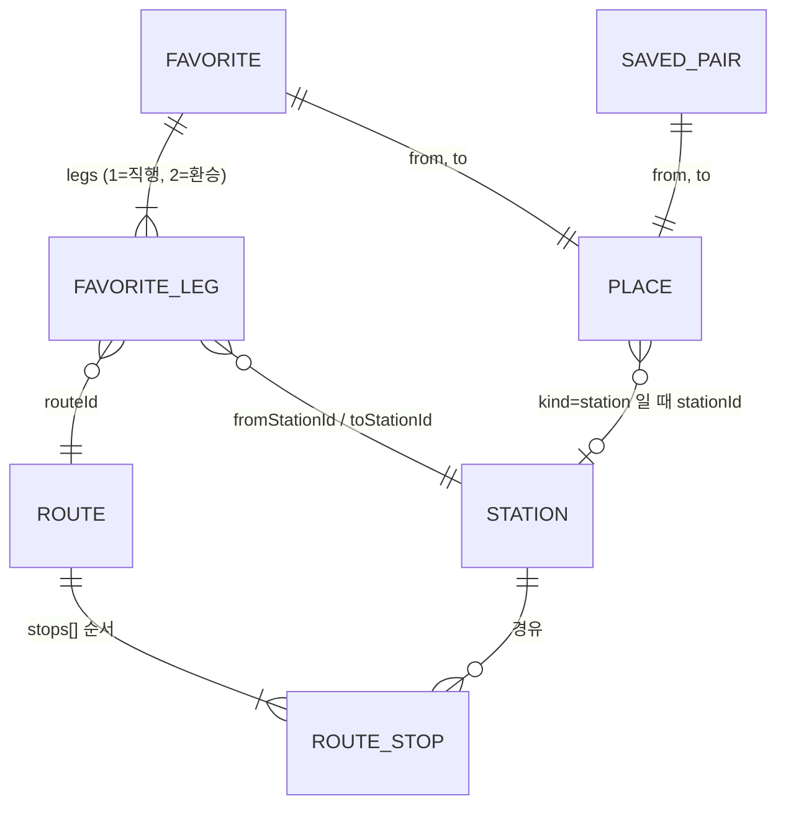

# 03. 데이터 스키마 — DB 없음

이 프로젝트에는 서버 DB 가 없다 (ADR-006, ADR-007).
- **정적 데이터**: `web/public/data/stations.json`, `routes.json` — `scripts/build-db.ts`가 생성, 주간 GitHub Actions 갱신(ADR-016). 브라우저가 `lib/data.ts` `loadDb()`로 받아 메모리 색인을 만든다. **읽기 전용**.
- **사용자 데이터**: 브라우저 localStorage 키 하나 (`lib/storage.ts`).
- 이번 리디자인에서 두 스키마 모두 **변경 없음**.

## 관계도

`ROUTE_STOP`은 별도 파일이 아니라 `routes[].stops` 배열(인덱스 = 순서)이다.

## stations.json (약 490KB)
```json
{ "updatedAt": "2026-11-19T11:04:30.117Z", "region": "성남", "partial": true, "pendingStations": 12,
  "stations": [ { "id": "206000004", "no": "07015", "name": "판교역", "x": 127.1112, "y": 37.3947, "sel": 1 } ] }
```
| 필드 | 타입 | 필수 | 설명 |
|---|---|---|---|
| updatedAt | string(ISO 8601) | ✓ | 수집 시각. 홈 푸터 "정류장 정보 기준" |
| region | string | ✓ | 수집 지역 ("성남") |
| partial | true | – | 일일 한도로 수집이 덜 끝남. 없으면 완료 |
| pendingStations | number | – | partial 일 때 남은 정류장 수 (화면 미사용) |
| stations[].id | string | ✓ | 경기도 stationId (PK). `/api/arrivals?stationId=` |
| stations[].no | string | ✓ | 정류장 번호(모바일 번호, 5자리). 성남 밖·경유 정류장은 `""` 가능 |
| stations[].name | string | ✓ | 정류장 이름 |
| stations[].x | number | ✓ | 경도 |
| stations[].y | number | ✓ | 위도 |
| stations[].sel | 1 | – | **성남시 + 번호 있음** = 출발·도착·환승으로 고를 수 있음 (ADR-010). 현재 5,189곳 중 1,275곳 |

- 성남 밖 정류장도 들어 있다(성남을 지나는 노선의 전체 정류장 순서용). 자동완성·지도·근처 검색(`grid`)은 `sel` 정류장만 쓴다.

## routes.json (약 280KB)
```json
{ "updatedAt": "2026-11-19T11:04:30.117Z",
  "routes": [ { "id": "241224001", "name": "2", "type": "마을버스", "region": "성남",
                "peek": 10, "npeek": 12, "first": "06:17", "last": "23:30", "turn": 26,
                "stops": ["206000261", "206000722", "..."] } ] }
```
| 필드 | 타입 | 설명 |
|---|---|---|
| id | string | routeId (PK). 도착정보 `routeId`와 같음 |
| name | string | 노선 번호(표시용) |
| type | string | 노선 종류 원문. 현재 값: `마을버스`, `일반형시내버스`, `직행좌석형시내버스`, `광역급행형시내버스`, `일반형시외버스`, `일반형 공항버스`, `리무진형 공항버스` (그 외 `좌석형시내버스` 등 가능) → 색은 01 문서 노선 종류 표 |
| region | string | 노선 등록 지역 (화면 미사용, `data.ts` 타입에도 없음) |
| peek | number \| null | 출퇴근(7–9시, 17–19시) 배차 분 |
| npeek | number \| null | 평시 배차 분. 둘 다 null 이면 15분으로 가정(`headwayMin`) |
| first / last | string | 기점 첫차/막차 `"HH:MM"`, 모르면 `""` → 운행 중으로 간주(`isRunning`) |
| turn | number | 회차 정류장 인덱스(0부터, 화면 미사용) |
| stops | string[] | 정류장 id 순서(최대 약 200). 같은 정류장이 두 번 나올 수 있음(왕복) → 위치는 인덱스로 구분, 도착정보 `staOrder = index+1` |

현재 299개 노선. `stops`의 모든 id 가 `stations`에 있다고 가정하지 말 것(`db.stations.get()` 결과 확인).

## 메모리 색인 (`BusDb`, loadDb 결과)
| 이름 | 타입 | 용도 |
|---|---|---|
| stations | `Map<id, Station>` | id 조회 |
| selectable | `Station[]` | `sel` 정류장 — 자동완성 색인 |
| routes | `Map<id, Route>` | |
| stopRefs | `Map<stationId, {route, index}[]>` | 정류장 → 지나는 노선과 위치 (경로 탐색) |
| grid | `SpatialGrid` (약 220m 칸) | `near(lat,lng,r)` 반경 검색, `inBounds()` 지도 마커 |

## localStorage — 키 `mybus-route:v1`
값 하나에 JSON 전체를 저장한다. 읽기 실패·파싱 실패·`version ≠ 1`이면 빈 값으로 시작하고, 쓰기 실패는 무시한다(사생활 보호 모드, ADR-007).
```ts
interface Store { version: 1; pairs: SavedPair[]; favorites: Favorite[] }

type Place =
  | { kind: "station"; stationId: string; label: string; lat: number; lng: number }  // label "판교역 (07015)"
  | { kind: "point"; label: string; lat: number; lng: number };                      // 주소·지도 위치

interface SavedPair { from: Place; to: Place; at: number /* 저장 시각 ms */ }

interface Favorite {
  id: string;            // Date.now().toString(36) + 랜덤 4자
  name: string;          // 기본 "출발 → 도착"(짧은 라벨), 사용자가 변경 가능
  from: Place; to: Place;
  legs: FavoriteLeg[];   // 1개 = 직행, 2개 = 환승
  walkStartSec: number; walkTransferSec: number; walkEndSec: number;
}
interface FavoriteLeg {
  routeId: string; routeName: string;   // routeName 은 표시용 사본
  fromIndex: number; toIndex: number;   // route.stops 인덱스
  fromStationId: string; toStationId: string;
}
```
| 목록 | 규칙 |
|---|---|
| pairs | 최신순, **최대 8개**. 같은 출발·도착 쌍(정류장=id, 위치=좌표 소수 5자리)은 앞으로 옮김. 삭제는 배열 인덱스 |
| favorites | 최신이 앞(`unshift`), 개수 제한 없음. 중복 판단 키 = `routeId:fromIndex-toIndex`를 `|`로 이은 문자열(`favoriteKey`) |

### 즐겨찾기 복원 (`favoriteToPlan`)
1. `routeId`가 DB 에 없으면 → null ("노선 정보가 바뀌었습니다").
2. 저장된 인덱스의 정류장 id 가 다르면 `indexOf`로 다시 찾는다(`toIndex`는 `fromIndex` 이후에서).
3. 못 찾거나 `toIndex ≤ fromIndex` → null.

### 버전 관리
- 형식을 바꿀 때는 `version: 2`와 새 키(`mybus-route:v2`)를 쓰고, `read()`에서 v1 을 읽어 변환한 뒤 저장한다. 이번 작업에서는 바꾸지 않는다.
- React 화면은 storage.ts 함수만 호출한다(직접 localStorage 접근 금지). 다른 탭과의 동기화(`storage` 이벤트)는 범위 밖.
